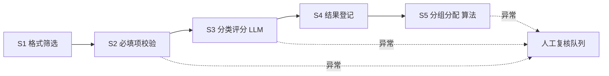

# doc-batch-pipeline

批量文档分类处理流水线：**格式筛选 → 必填项校验 → 内容分类与评分 → 结果登记 → 分组分配**，输出 xlsx 结果 + 人工复核队列。

## 架构图



## 快速开始

```bash
# 1. 克隆并安装（仓库名 agent-classify，Python 包名为 doc-batch-pipeline）
git clone https://github.com/octpus1230216-alt/agent-classify.git
cd agent-classify
python -m venv .venv && source .venv/bin/activate
pip install -e ".[dev]"

# 2. 配置规则（复制示例并按需修改）
cd config
cp config.example.yaml config.yaml
cp schema.example.yaml schema.yaml
cp scoring.example.yaml scoring.yaml
cp grouping.example.yaml grouping.yaml
cd ..

# 3. 配置模型接口（复制为 .env 后填入真实值）
cp .env.example .env
#   OPENAI_API_KEY / OPENAI_BASE_URL 指向实际模型服务；
#   私有化部署时把 OPENAI_BASE_URL 改为内网推理端点（如 vLLM / Ollama 兼容接口），
#   业务规则与流水线代码无需改动。

# 4. 放入待处理文档到 data/input/

# 5. 运行
python -m pipeline.cli --input data/input --config config
```

查看帮助：`python -m pipeline.cli --help`

运行测试：`pytest tests/`

## 规则文件说明

详见 [`docs/rule-format.md`](docs/rule-format.md) 与 [`config/README.md`](config/README.md)。

模型层已抽象为统一接口，切换 OpenAI / Qwen / DeepSeek 等兼容服务只需改 `.env` 中的 `OPENAI_BASE_URL` 与模型名，业务规则与流水线代码零改动。

## 隐私声明

- 仓库仅提交脱敏的 `*.example.yaml` 占位规则。
- 真实规则文件（`config/*.yaml`）、输入输出数据（`data/`）、密钥（`.env`）均已被 `.gitignore` 排除，不会入库。
- 大模型仅用于 Stage 3 分类评分环节，分组分配由确定性算法实现。
- 全部文档处理在本地完成，仅调用模型接口时会传出待评分的文本片段；私有化部署可将 `OPENAI_BASE_URL` 指向内网推理端点，数据不出内网。

## 当前状态

本仓库是**可运行的最小完整实现（教学/演示基线）**，用于验证"确定性代码兜底 + 异常转人工"这一架构骨架。已知未完成项见下方 TODO。生产使用前需按实际模板补齐字段解析与分组优化。

## TODO

- [ ] Stage 2 字段提取目前为占位键值解析，需根据实际模板结构定制。
- [ ] Stage 5 阶段 B 可升级为 OR-Tools CP-SAT 求解器（已预留接口，见 `grouping/adjust.py`）。
