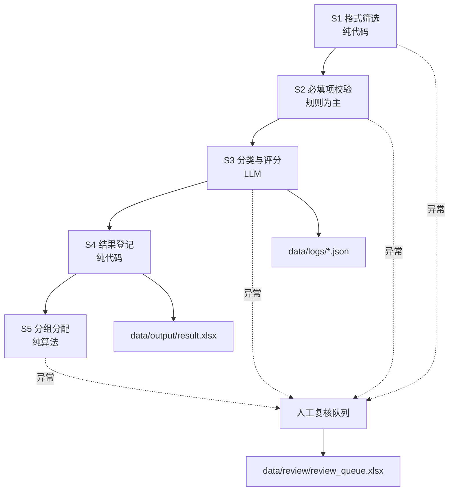

# 架构说明

## 流水线阶段

## 设计原则

1. **单 Agent / 流水线**：不使用多 Agent 协作框架。大模型仅用于 S3；分组用确定性算法。
2. **规则与代码分离**：所有字段/分类/评分/分组规则在 `config/*.yaml`。
3. **统一 Stage 接口**：每个 Stage 实现 `BaseStage.run()`，返回 `StageResult(passed, review)`。
4. **异常闭环**：异常项不丢弃，统一进入人工复核队列。
5. **可复现**：分组算法同样输入得到同样输出，并有确定性单元测试。

## 模块划分

| 模块 | 职责 |
|------|------|
| `stages/` | 五个处理阶段 |
| `parsers/` | docx / pdf 文本与表格提取 |
| `llm/` | 大模型抽象 + OpenAI 兼容实现 + Prompt 模板 |
| `rules/` | YAML 加载 + 字段校验 |
| `grouping/` | 阶段 A 贪心分配 + 阶段 B 再分配 |
| `utils/` | 文件扫描、日志、缓存 |
